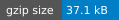
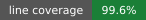
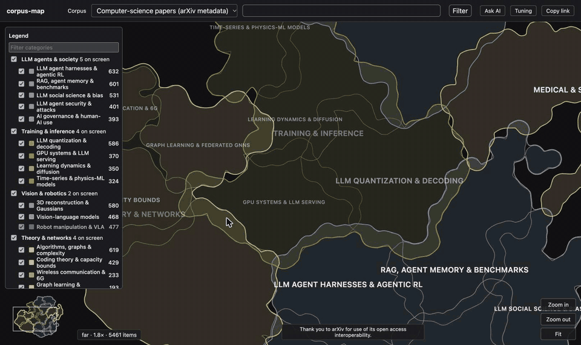

🇺🇸 [English](README.md) · 🇧🇷 [Português](README.pt.md)

[](https://github.com/albertosca/corpus-map/actions/workflows/ci.yml) [](https://github.com/albertosca/corpus-map/actions/workflows/lint.yml)  [](https://github.com/albertosca/corpus-map/actions/workflows/ci.yml)

# corpus-map

Uma biblioteca React que transforma coordenadas pré-computadas num mapa com zoom: de longe você vê territórios nomeados, e ao se aproximar eles se abrem em seus itens.

## Instalação

```sh
npm install corpus-map
```

Requer React 18 ou superior.



**[Experimente a demo ao vivo](https://albertosca.github.io/corpus-map/)**: cerca de 8.000 artigos de ciência da computação do arXiv.

## Início rápido

```tsx
import { CorpusMap, validateSpec } from "corpus-map";

const spec = validateSpec({
  version: "1",
  territories: [{ id: "alkali", name: "Alkali metals", members: ["li"], centroid: [1, 2] }],
  nodes: [{ id: "li", label: "Lithium", x: 1, y: 2, territory: "alkali" }],
});

export function Map() {
  return <CorpusMap spec={spec} renderCard={(node) => <strong>{node.label}</strong>} width={960} height={640} />;
}
```

Crie o `spec` uma vez, fora do render. Sem `width` e `height`, o mapa preenche o elemento pai.

## O que você recebe

- **O zoom é o nível de detalhe.** De longe, territórios nomeados (opcionalmente agrupados em famílias). Mais perto, seus itens, os mais relevantes rotulados. Um cartão para o item selecionado.
- **Qualquer domínio.** Você fornece coordenadas, territórios e um renderizador de cartão. A biblioteca nunca lê o seu `meta`.
- **Feita para cerca de 10.000 itens** em Canvas 2D. Sem WebGPU nem WebGL.
- **Acessível por teclado e leitor de tela**, com uma auditoria de acessibilidade na suíte de testes.
- **Extras opcionais**, cada um com sua própria entrada: busca, filtro por atributo, uma caixa de diálogo para a sua própria IA e um verificador de tema.
- **Controlável**: visão, seleção e territórios ocultos podem ser guiados pelo seu próprio estado. Gestos de toque e minimapa já vêm prontos.

Não é uma biblioteca de grafos. Ela não calcula layout nem roda simulação de força.

## Documentação

A documentação está em inglês.

- [Concepts](docs/concepts.md): o que é, como se compara às vizinhas, as três camadas.
- [The map spec](docs/map-spec.md): o formato dos dados, territórios, famílias, arestas.
- [Usage reference](docs/usage.md): cada prop, o handle, viewport, seleção, cartões.
- [Add-ons](docs/addons.md): busca, assistente, filtro.
- [Styling](docs/styling.md): temas e o verificador de tema.
- [Accessibility](docs/accessibility.md): teclas, leitores de tela, o que é auditado.
- [The demo](docs/demo.md): o que ela mostra e como rodar.
- [Quality gates](docs/quality.md): cobertura, tamanho e checagem da API.
- [ARCHITECTURE.md](ARCHITECTURE.md): a organização do código, para quem contribui.

## Situação

- A acessibilidade é testada por máquina (axe, Lighthouse) e por percurso de teclado. Uma passada com um leitor de tela de verdade (VoiceOver, NVDA) ainda está pendente.
- Nenhuma taxa de quadros medida no navegador é afirmada. O benchmark mede só o tempo de CPU do pintor, veja [Concepts](docs/concepts.md#performance).

## Créditos e licença

O [CREDITS.md](CREDITS.md) lista a arte anterior em que esta biblioteca se apoia e as restrições de licença respeitadas no caminho.

Licenciada sob a [Licença MIT](LICENSE).
